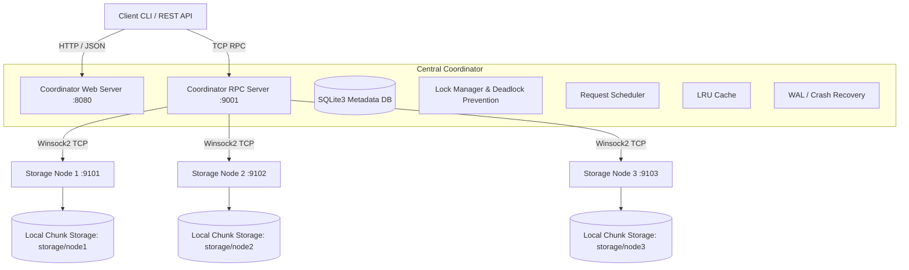

# Advanced Distributed File System (DFS)

An enterprise-grade, distributed file system built in modern C++ (C++20) for Windows. This project implements core Operating Systems concepts—such as multi-threading, concurrency control, inter-process communication (IPC), asynchronous networking, distributed transactions with Write-Ahead Logging (WAL), disk scheduling algorithms, and fault tolerance—paired with a real-time responsive web dashboard.

---

## 🌟 Key Features & Operating System Concepts

| OS Concept / Component | Implementation Details |
| :--- | :--- |
| **Process Management & IPC** | Native Win32 `CreateProcess` lifecycle management, process monitoring, graceful shutdown, and cross-process telemetry via Winsock2 TCP sockets. |
| **Concurrency & Synchronization** | Reader-Writer locks (`SharedRead` / `ExclusiveWrite`) with Havender's resource ordering to prevent circular-wait deadlocks, lock timeouts, and thread-safe bounded buffers. |
| **Asynchronous Scheduling** | Pluggable request scheduling (FCFS, Priority, Round Robin) alongside simulation of classic disk head scheduling algorithms (FCFS, SSTF, SCAN, C-SCAN, LOOK, C-LOOK). |
| **Write-Ahead Logging (WAL) & Recovery** | ACID-compliant transaction logging with automated crash recovery and rollback mechanisms for uncommitted distributed writes. |
| **Metadata Management** | SQLite3-backed catalog tracking file hierarchy, chunk IDs, replica distributions, ownership, permissions, and cryptographic integrity hashes. |
| **Replication & Fault Tolerance** | Dynamic chunk replication across independent storage node processes, automatic heartbeat failure detection, and transparent read failover. |
| **Data Integrity & Security** | Cryptographic SHA-256 chunk hashing, path traversal attack mitigation (`../` sanitization), and POSIX-style octal permission checks (`chmod`). |
| **Distributed LRU Cache** | High-performance thread-safe LRU caching layer with automatic write-through cache invalidation. |
| **Real-Time Web Dashboard** | Embedded C++ HTTP server serving an interactive dashboard displaying cluster topology, node metrics, active locks, scheduling queues, and visual file explorer. |

---

## 🏗️ Architecture Overview



---

## 📁 Project Structure

```plaintext
os/
├── CMakeLists.txt             # Build configuration (C++20, SQLite3, Winsock2, Psapi)
├── start-cluster.ps1          # Automated cluster bootstrap script
├── stop-cluster.ps1           # Graceful cluster teardown script
├── run-tests.ps1              # Automated test runner for 10 OS subsystem test suites
├── config/
│   └── cluster_config.json    # Coordinator and storage node cluster topology config
├── dashboard/                 # Real-time Web UI assets (HTML5, Vanilla CSS, JS)
├── include/                   # Public header declarations
├── src/
│   ├── client/                # CLI Client implementation (main.cpp)
│   ├── common/                # Shared utilities, Logger, SHA-256, JSON helper
│   ├── coordinator/           # Central Coordinator server & orchestration
│   ├── disk/                  # Disk scheduling simulation (FCFS, SSTF, SCAN, etc.)
│   ├── metadata/              # SQLite metadata database engine
│   ├── networking/            # Winsock2 TCP client/server abstractions & protocols
│   ├── process/               # Win32 Process spawning and monitoring
│   ├── recovery/              # Write-Ahead Log (WAL) and crash recovery engine
│   ├── scheduler/             # Request queues, priority scheduling, bounded buffers
│   ├── security/              # Path sanitization, authentication, and permission engine
│   ├── storage_node/          # Storage node process & chunk persistence
│   ├── sync/                  # Reader-Writer locks & deadlock prevention
│   ├── tests/                 # 10-part automated OS integration test suite
│   └── web/                   # Embedded HTTP web server for REST API & Dashboard
└── storage/                   # Physical storage directories for worker nodes (node1, node2, node3)
```

---

## ⚙️ Prerequisites & Environment Setup

Before building and running the project, make sure the following are installed and added to your `PATH`:

- **Operating System:** Windows 10 or 11 (64-bit)
- **Compiler:**
  - **MinGW-w64 / GCC** (e.g. from `w64devkit`, MSYS2, or WinLibs) supporting **C++20**, or
  - **MSVC (Visual Studio 2019/2022)** with C++20 standard support
- **Build System:** **CMake 3.20** or higher
- **Shell:** **PowerShell 5.1+** or **PowerShell 7+**
- **Libraries Linked (built-in Windows):** `ws2_32` (Winsock2), `psapi` (Process Status API), and embedded `sqlite3`.

---

## 🚀 How to Run This Project

### Method 1: One-Click Startup Script (Recommended)

The easiest way to build and run the entire cluster is using the provided automated script:

```powershell
# Open PowerShell in the project root directory
cd e:\hp\Documents\os

# Run the cluster startup script
.\start-cluster.ps1
```

#### What happens behind the scenes:
1. **Compiles Code:** If binaries are missing, it automatically creates a `build/` folder and runs CMake + Make.
2. **Creates Directories:** Ensures `storage/node1`, `storage/node2`, `storage/node3`, and `data/` directories exist.
3. **Cleans Stale Processes:** Terminates any previously running `dfs_coordinator` or `dfs_storage_node` processes to free up ports.
4. **Starts Coordinator:** Launches `dfs_coordinator.exe` on HTTP port **`8080`** and RPC port **`9001`**.
5. **Starts 3 Worker Storage Nodes:** Launches independent background processes for Node 1 (`:9101`), Node 2 (`:9102`), and Node 3 (`:9103`).
6. **Opens Dashboard:** Automatically opens your default web browser to:
   ```
   http://127.0.0.1:8080/
   ```

---

### Method 2: Manual Build & Execution

If you prefer building and launching each component step-by-step in separate terminal windows:

#### Step 1: Build Binaries with CMake
```powershell
# From project root
mkdir build -Force
cd build

# For MinGW / w64devkit:
cmake -G "MinGW Makefiles" -DCMAKE_BUILD_TYPE=Release ..
make -j4

# Or for Visual Studio:
# cmake -G "Visual Studio 17 2022" ..
# cmake --build . --config Release

cd ..
```

#### Step 2: Copy Static Dashboard and Config to Build Folder
```powershell
Copy-Item -Path "dashboard" -Destination "build\dashboard" -Recurse -Force
Copy-Item -Path "config" -Destination "build\config" -Recurse -Force
```

#### Step 3: Run Central Coordinator Server (Terminal 1)
```powershell
.\build\dfs_coordinator.exe --web-port 8080 --rpc-port 9001 --db data/dfs_metadata.db --dashboard-dir dashboard
```

#### Step 4: Run Storage Nodes (Terminals 2, 3, and 4)
Open three new PowerShell terminals and run:

```powershell
# Terminal 2 (Node 1):
.\build\dfs_storage_node.exe --id 1 --port 9101 --dir storage/node1 --coord-port 9001

# Terminal 3 (Node 2):
.\build\dfs_storage_node.exe --id 2 --port 9102 --dir storage/node2 --coord-port 9001

# Terminal 4 (Node 3):
.\build\dfs_storage_node.exe --id 3 --port 9103 --dir storage/node3 --coord-port 9001
```

Now open `http://127.0.0.1:8080/` in any browser.

---

### 🛑 How to Stop the Project

To stop all running background cluster processes cleanly:

```powershell
.\stop-cluster.ps1
```

If you ran them manually in separate windows, simply press `Ctrl+C` in each terminal window (the built-in Win32 console handler will flush logs and exit gracefully).

---

## 💻 Client CLI Usage & Command Reference

The command-line client (`build\dfs_client.exe`) enables interactive testing and file manipulation directly from PowerShell:

### Basic File Operations
```powershell
# 1. View all CLI commands
.\build\dfs_client.exe help

# 2. Upload a local file into the distributed file system
# Syntax: dfs_client upload <local_file> <dfs_path> [user] [replication_factor]
.\build\dfs_client.exe upload README.md /docs/README.md admin 2

# 3. Download a file back to your local filesystem
# Syntax: dfs_client download <dfs_path> <local_file> [user]
.\build\dfs_client.exe download /docs/README.md downloaded_readme.md admin

# 4. List all files currently in DFS
.\build\dfs_client.exe list

# 5. Search for files by name/substring
.\build\dfs_client.exe search README

# 6. Rename a file in the namespace
.\build\dfs_client.exe rename /docs/README.md /docs/README_v2.md admin

# 7. Delete a file
.\build\dfs_client.exe delete /docs/README_v2.md admin
```

### OS Subsystem Diagnostics Commands
```powershell
# Display active nodes, health, ports, and storage utilization
.\build\dfs_client.exe nodes

# Display overall cluster status
.\build\dfs_client.exe status

# Inspect LRU Cache hits, misses, evictions, and hit-ratio
.\build\dfs_client.exe cache

# Inspect Lock Manager (readers/writer active locks, wait queues, deadlock checks)
.\build\dfs_client.exe locks

# Inspect Bounded Buffer occupancy, throughput, and backpressure
.\build\dfs_client.exe buffer

# Inspect Request Scheduler algorithm (FCFS/Priority) and pending requests
.\build\dfs_client.exe scheduler
```

---

## 🧪 Running the Automated Test Suite

The project includes an end-to-end automated testing suite with 10 test suites covering all OS components:

```powershell
.\run-tests.ps1
```

### What the 10 Test Cases Validate:
1. **Test 1: Basic File Operations** - Validates upload, download, search, rename, and deletion flows.
2. **Test 2: Concurrency & Synchronization** - Validates 4 simultaneous readers and 2 writers operating concurrently under reader-writer locks.
3. **Test 3: Reader-Writer Locks & Deadlock Prevention** - Verifies shared read concurrency, exclusive write locking, lock acquisition timeouts, and Havender's hierarchical multi-lock ordering.
4. **Test 4: Bounded Buffer Backpressure** - Verifies producer blocking when buffer capacity is exceeded and proper FIFO draining.
5. **Test 5: Replication & SHA-256 Checksums** - Validates multi-node chunk replication and byte-for-byte cryptographic integrity verification.
6. **Test 6: Node Failure Simulation & Failover** - Simulates killing an active storage node and proves transparent failover read from surviving replicas with zero data loss.
7. **Test 7: Crash Recovery & Write-Ahead Log (WAL)** - Simulates mid-transaction coordinator crashes and validates automated rollback of uncommitted transactions upon reboot.
8. **Test 8: Security & Path Traversal Prevention** - Ensures malicious traversal strings (e.g. `../../windows/system32/cmd.exe`) are blocked and permission bits enforced.
9. **Test 9: Distributed LRU Cache & Invalidation** - Verifies cache miss on first read, cache hit on repeat read, and automatic cache invalidation upon file modification.
10. **Test 10: Scheduling & Disk Simulation** - Validates FCFS vs. Priority queue order and compares disk seek distances (FCFS, SSTF, SCAN, LOOK).

---

## 🌐 Web Dashboard & REST API Endpoints

Once running, navigate to `http://127.0.0.1:8080/`. The dashboard updates live and allows full cluster administration:

| Endpoint | Method | Purpose |
| :--- | :--- | :--- |
| `/api/status` | `GET` | Cluster status, uptime, and high-level counters |
| `/api/nodes` | `GET` | Storage nodes status, IPs, ports, and storage utilization |
| `/api/files` | `GET` | File catalog with sizes, chunk maps, replicas, and checksums |
| `/api/cache` | `GET` | Real-time LRU cache hit/miss performance metrics |
| `/api/locks` | `GET` | Active file locks, holding clients, and deadlock status |
| `/api/buffer` | `GET` | Bounded buffer occupancy and backpressure stats |
| `/api/scheduler` | `GET` | Request scheduler queue size and active scheduling algorithm |
| `/api/upload` | `POST` | Upload file payload via HTTP REST |
| `/api/download` | `POST` | Download file payload via HTTP REST |
| `/api/delete` | `POST` | Delete a file via HTTP REST |

---

## 🔧 Important Port & Configuration Reference

Config file: `config/cluster_config.json`

| Service | Port | Protocol | Purpose |
| :--- | :--- | :--- | :--- |
| **Coordinator Web Dashboard** | `8080` | HTTP | Browser GUI & REST API |
| **Coordinator RPC** | `9001` | TCP (Winsock2) | Node registration, heartbeat, chunk routing |
| **Storage Node 1** | `9101` | TCP (Winsock2) | Chunk data read/write storage |
| **Storage Node 2** | `9102` | TCP (Winsock2) | Chunk data read/write storage |
| **Storage Node 3** | `9103` | TCP (Winsock2) | Chunk data read/write storage |
| **SQLite Metadata DB** | — | File | `data/dfs_metadata.db` |

---

## ❓ Troubleshooting & FAQs

- **Port Conflict (e.g. `Address already in use` / Port 8080 or 9001 busy):**
  Run `.\stop-cluster.ps1` to stop lingering instances, or run `Get-Process dfs_* | Stop-Process -Force` in PowerShell.
- **Compiler not recognized:**
  Ensure MinGW-w64 (`g++`) or MSVC is present in your Windows `PATH`. (If using `w64devkit` at `E:\tools\w64devkit\bin`, `start-cluster.ps1` detects it automatically).
- **Storage nodes not appearing on dashboard:**
  Verify that storage node ports (`9101-9103`) and coordinator port (`9001`) are not blocked by Windows Defender Firewall for localhost connections.

---

## 📜 License
This project is open-source and intended for educational, Operating Systems demonstrations, and viva presentations.
